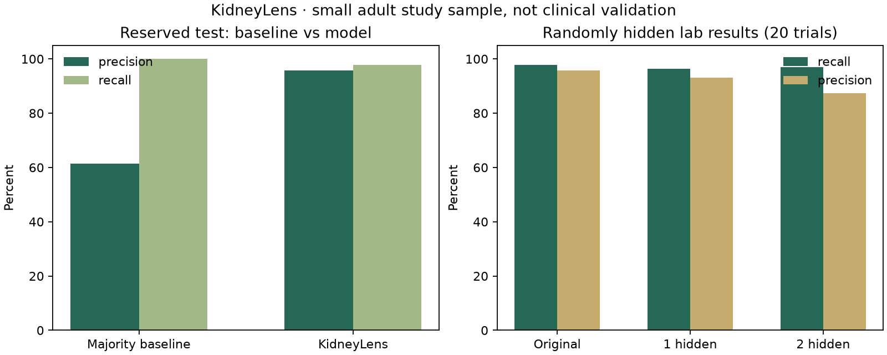

# KidneyLens: methods and limitations

## Data

Source: [UCI 336](https://archive.ics.uci.edu/dataset/336/chronic+kidney+disease), Rubini et al. (2015), [CC BY 4.0](https://creativecommons.org/licenses/by/4.0/). CSV: `https://archive.ics.uci.edu/static/public/336/data.csv`. SHA-256: `0eeea8d17f5ad8792d854999d6ddf1602ec4e116616f6ccdfdaef0ba8109e694`.

400 rows, 24 features, class label. Trim label whitespace and map ckd=1, notckd=0. Parse selected features numerically; question marks, tab-question-marks and empty cells are unknown. Exclude 19 children and 9 unknown ages. The 372 retained adults have 226 CKD labels. This selected sample’s prevalence is not a population estimate.

| Feature | Interpretation | Preprocessing |
| --- | --- | --- |
| age | Age in years | Training median + StandardScaler |
| bgr | Random blood glucose, mg/dL | Training median + StandardScaler |
| bu | Blood urea, mg/dL; not BUN | Training median + StandardScaler |
| sc | Serum creatinine, mg/dL | Training median + StandardScaler |
| hemo | Hemoglobin, interpreted as g/dL | Training median + StandardScaler |
| sg | Nominal categories 1.005/1.010/1.015/1.020/1.025 | Training mode + one-hot |
| al | Nominal study grade 0–5; not urine ACR | Training mode + one-hot |

UCI abbreviates hemoglobin units as grams; the app uses the conventional g/dL interpretation of these study values, not a validated interoperability mapping. Do not convert unspecified reports. Blood pressure is omitted because the source does not identify systolic versus diastolic measurement. Diagnosis-like hypertension/diabetes features are omitted to focus on the laboratory question.

## Split and model selection

Hash the seven selected input values to keep identical profiles together. First test fold: `StratifiedGroupKFold(5, shuffle=True, random_state=15112026)`. Within its remainder, first validation fold: `StratifiedGroupKFold(4, shuffle=True, random_state=15112027)`.

| Partition | Rows | CKD labels |
| --- | ---: | ---: |
| Training | 223 | 135 |
| Validation | 74 | 45 |
| Test | 75 | 46 |

No selected-input profiles overlap; all retained profiles are unique in this version. No patient IDs, timestamps or hospital partitions are available. Profile grouping is not proof of patient-level separation or external validity. All imputation and scaling fit only training data. Category definitions are fixed from UCI documentation; missingness indicators are not additional features.

Fit logistic regression with C=0.1, 1, 10. For each candidate, on validation choose a threshold maximizing precision with recall ≥90%, breaking ties by higher recall then lower threshold. Compare candidates by validation precision, recall, then smaller C. Freeze before test evaluation. Winner: C=1, threshold 0.31710981850989667. The deployed model remains trained on the 223 training rows; it is not refit on test/validation. No test-driven tuning was performed.

## Reserved test results

TP=45, FP=2, FN=1, TN=27. Accuracy 96.0%, precision 95.7447%, recall 97.8261%, ROC AUC 0.99775. Approximate Wilson intervals: recall 88.7–99.6%, precision 85.8–98.8%. These intervals condition on the selected model and omit model-selection, transfer and dataset-design uncertainty.

Majority baseline always predicts CKD: TP=46, FP=29, FN=0, TN=0, accuracy/precision 61.3333%, recall 100%. The model reduces false alarms but introduces one miss; it does not improve every metric.

Errors, using test-array positions (not patient IDs):

- Position 16 / displayed example 17: CKD label, score 0.3040136, missed.
- Position 63 / example 64: non-CKD label, score 0.3637704, false alarm.
- Position 65 / example 66: non-CKD label, score 0.3504149, false alarm.

All had unknown hemoglobin. This association does not establish the reason for individual errors. Only four positive test cases are aged 18–44: 100% recall in that subgroup is 4/4, not evidence of fairness. Full subgroup counts and intervals are in results JSON. Sex/race variables are absent from the dataset; no sex/race fairness claim is made.

## Missingness experiment

After model selection, hide one or two additional observed lab values per test row, never age, with seeds 1000–1019. Keep the same fitted preprocessing, model and threshold. Unknowns are imputed. Existing missing values can bring a row beyond the UI guardrail: this evaluates the classifier on **all 75 test rows**, not only app-accepted panels.

| Condition | Mean precision | Mean recall |
| --- | ---: | ---: |
| Original | 95.7% | 97.8% |
| One more lab hidden | 93.1% | 96.3% |
| Two more labs hidden | 87.5% | 97.0% |

Recall need not decrease monotonically; imputing can generate more positive flags and false alarms. Random masking does not model all real missingness mechanisms or different laboratories. Missingness itself can encode shortcuts, even without explicit indicators.

## Inference and interface policies

The JSON export contains five numeric medians/means/scales, two category-mode values, eleven category levels, full-precision logistic coefficients, intercept and threshold. Browser score = sigmoid(intercept + dot(transformed inputs, coefficients)). Python/JavaScript parity examples are artificial, not source records.

Absent adult age, >2 missing fields, invalid categories, non-finite values or numeric values outside the observed training range withhold the score. No value is clipped. These are demo usability/support heuristics, not validated clinical rules. A score within 0.10 of the classification threshold gets a near-boundary label; this is not a calibrated confidence interval. Zero stays zero, never missing.

Numeric explanations are coefficient × standardized input. Categorical explanations compare the current category weight to the training-mode category. They are reference-relative model associations, not causal effects or advice to change a lab value.

The benchmark includes all test records, including ones the app may withhold. Abstention changes coverage; the interface’s abstention policy has not been validated as a clinical decision policy.

## Limitations

- Small, selected, single-source retrospective dataset. No external/prospective validation or calibrated personal probabilities.
- Labs relate to existing diagnostic assessment; this is current label classification, not proof of earlier detection.
- Measurement conventions and ordinal study grades may not match current clinical reports.
- The source includes outliers. Study training ranges are not normal ranges or safe/unsafe medical boundaries.
- Imputation hides information; complete panels can also be wrong. Subgroup samples are small.
- No test-failure-specific retraining, resampling or feature selection was performed.

## Reproduction and privacy

`python train.py` verifies source bytes, trains, and emits model JSON, aggregate results, artificial parity cases and the figure. Package versions and split index hashes are recorded. The ignored `.cache/` is not committed or served. No trained pickle is required.

`node tests/test_inference.cjs` checks Python/JS parity, unchanged inputs, missing/zero distinctions, range and category guards. `python serve.py` serves an explicit public asset allowlist on loopback. Source folders, `.git`, cached data and environment files are not reachable through it. GitHub Pages serves the public repository. No lab values are uploaded, stored or logged; no analytics or model API is used. Only static model and synthetic-example assets are fetched.

